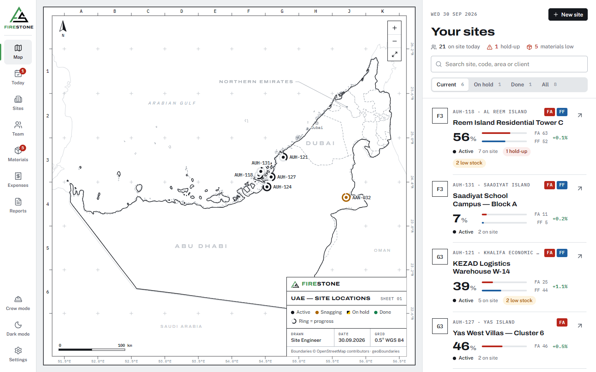
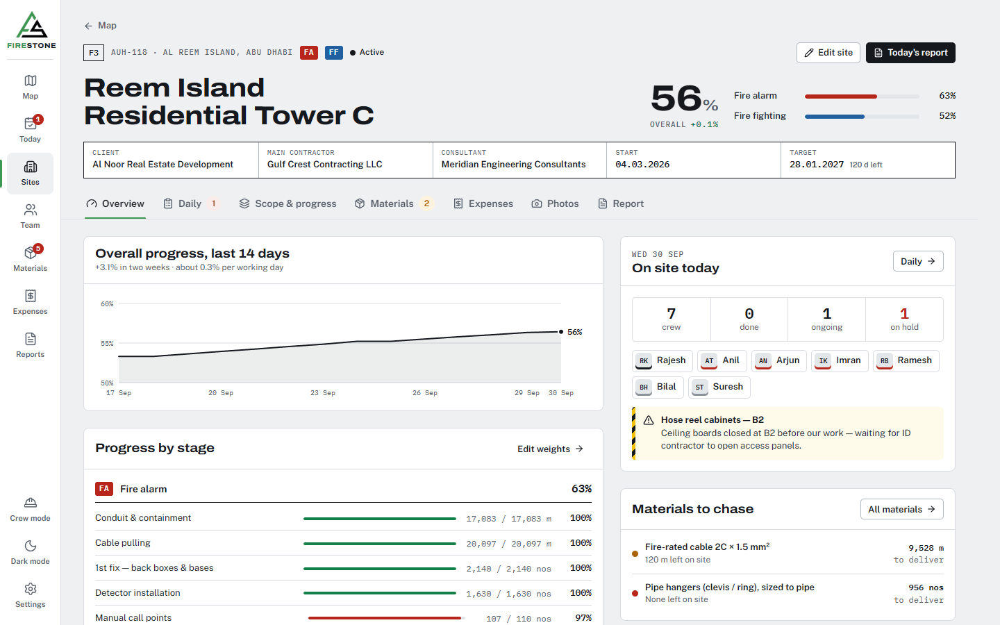
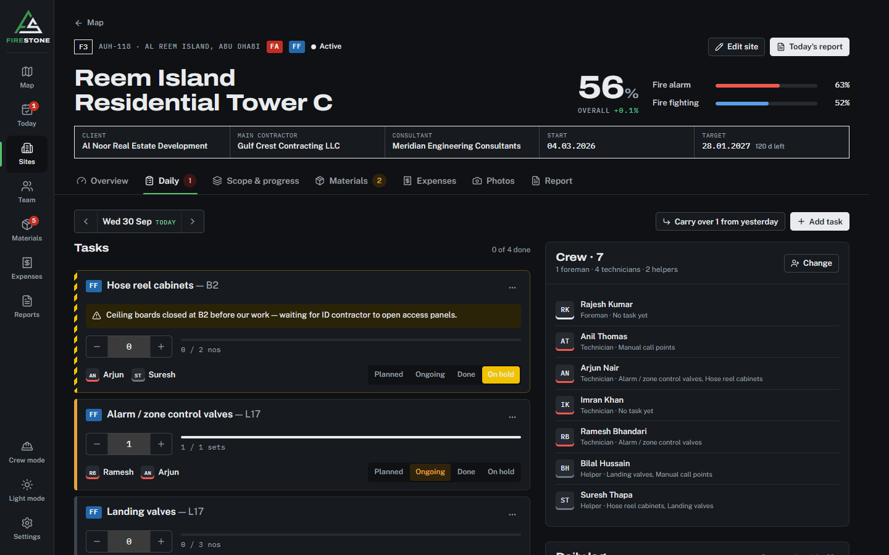
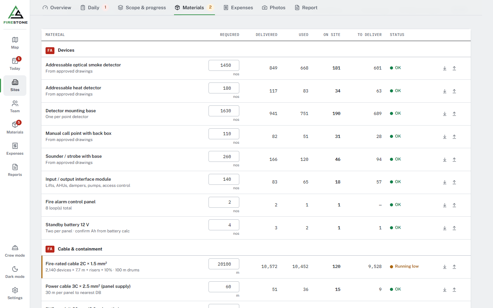
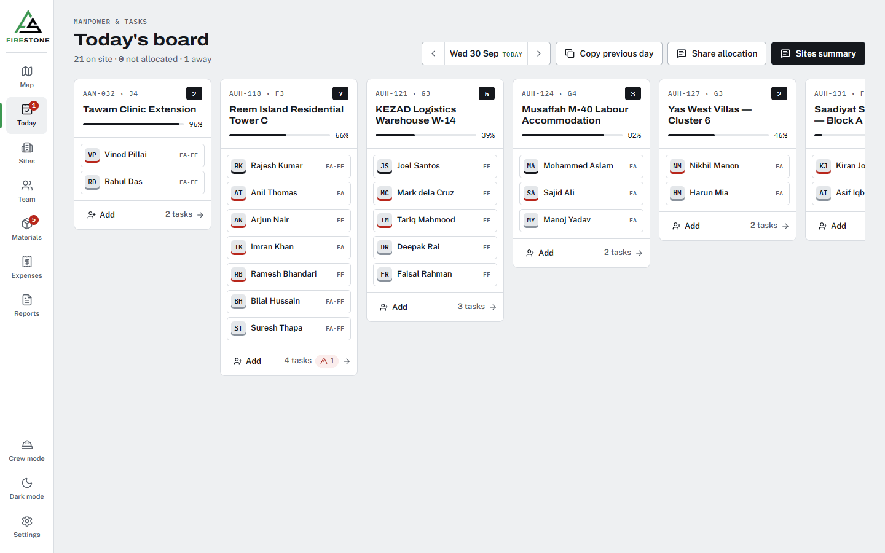
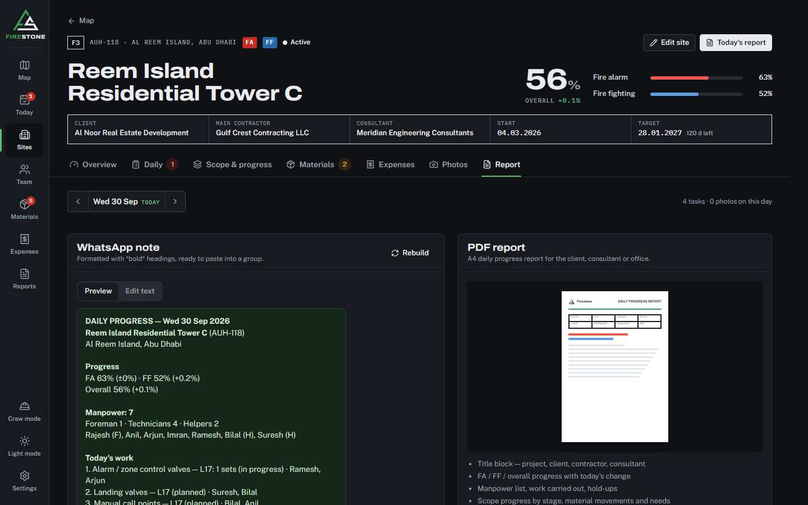
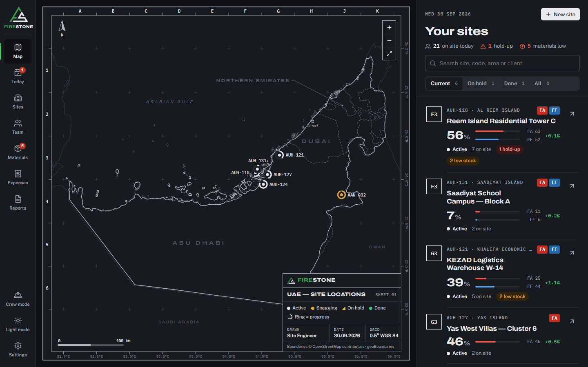
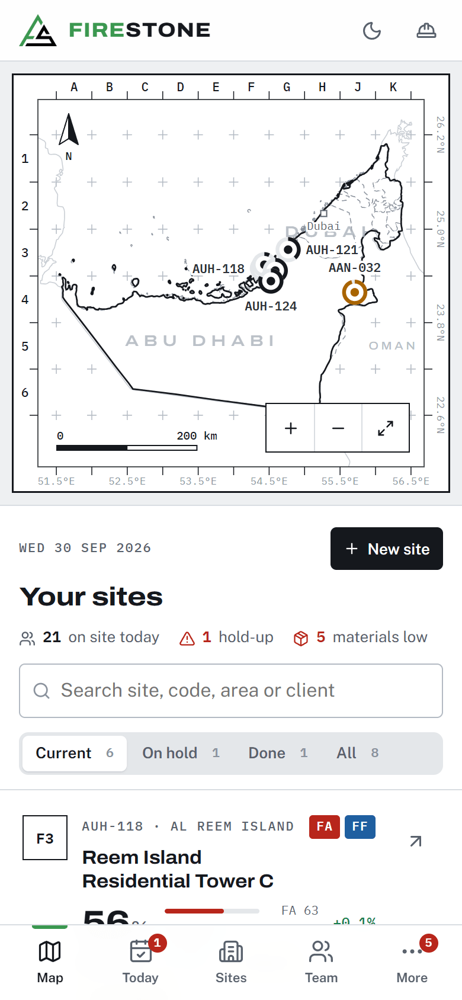
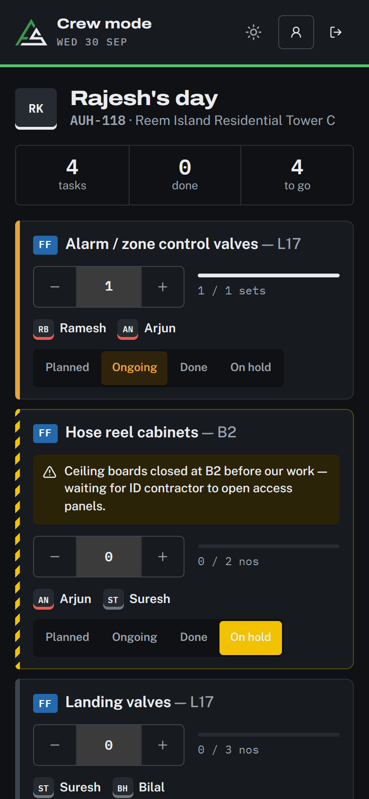

<p align="center">
  
</p>

<h1 align="center">Firestone Site Manager</h1>

<p align="center">
  Site management for <b>fire alarm</b> and <b>fire fighting</b> projects across the UAE —<br />
  every site on one map, daily tasks per technician, live progress, materials, expenses, photos and reports.
</p>

<p align="center">
  <b>Live demo:</b> see the website link in the <i>About</i> box on this page ·
  <a href="#features">Features</a> ·
  <a href="#run-it-locally">Run it locally</a> ·
  <a href="#how-it-works">How it works</a>
</p>



> The app starts empty. To look around first, open **Settings → Load sample data** (8 example sites, 22 crew, two weeks of history). Everything you add stays in your own browser.

## Why

A site engineer running several fire safety installations at once juggles WhatsApp groups, Excel sheets and paper. This app puts it in one place that works on a laptop in the office **and** a phone on site — even without signal.

## Features

| | |
|---|---|
| **Map home** | The UAE drawn as an engineering drawing sheet — zone grid on a real 0.5° graticule (A–K / 1–6), title block, north arrow and scale. Each site is a pin with a progress ring; its grid reference (e.g. `F3`) links the list and the map. Everything about a site — team, today's tasks, materials, expenses, photos, reports — lives inside that site. |
| **Start from the drawings** | When adding a site, drop in the drawing PDFs or photos. Claude reads the title blocks, legends and device schedules in the background, fills in the project details, building conditions and FA/FF quantities for you to check, asks a few simple questions about anything unclear, and compares the drawings with the pin on a satellite view. Uses your own Claude API key (Settings → Drawing reader); the drawings are kept with the site. |
| **Scope → progress %** | Enter FA/FF quantities from the approved drawings. The app builds weighted installation stages (containment → cabling → devices → panel → testing → Civil Defence) and calculates FA, FF and overall progress. |
| **Progress from highlighted drawings** | For lump-sum work where counting every head is impractical: drop in the drawings your team has highlighted (in a PDF app, or with pens on paper and scanned). Claude reads each colour, you confirm what it means, and the stage percentages update. |
| **Daily tasks** | Tasks per technician and helper with quantity targets, status, hold-ups (with reason), one-tap carry-over and a daily log. Quantities entered on tasks move the site's progress. |
| **Team per site** | Each site's Team tab: choose the day's crew, bring people over from another site, mark leave or absence, repeat yesterday's crew, and add new technicians and helpers right there. |
| **Materials by site conditions** | Required quantities worked out from the scope *and* the building: void detectors when the ceiling void is over 800 mm, 79 °C heads in non-air-conditioned spaces, NFPA 13 hanger spacing and spare heads, grooved vs threaded pipe, beam clamps on steel. The reason is shown next to every line. |
| **Materials on site** | For every material: needed (from the drawings), requested, delivered, used and on site, with low-stock alerts. Material requests are saved as “requested” until delivered and sent as a WhatsApp message; deliveries carry DN numbers. |
| **Expenses & photos** | Running costs by category and site in AED. Photos are taken from the phone camera, compressed and kept on the device. |
| **Reports** | A4 PDF reports (daily site report, weekly summary, materials, expenses) and WhatsApp-formatted notes (daily progress, all-sites summary, manpower allocation). Site reports are in each site's Report tab; the all-sites ones are under Share on the map. |
| **Crew mode** | A foreman opens their own task list on a shared site phone with a 4-digit PIN. |
| **Works offline, light & dark** | Installable PWA; data lives in the browser (IndexedDB) with backup / restore to a file. Light and dark themes, with a bold high-visibility cursor for the white map. |

<table>
  <tr>
    <td></td>
    <td></td>
  </tr>
  <tr>
    <td></td>
    <td></td>
  </tr>
  <tr>
    <td></td>
    <td></td>
  </tr>
</table>

<p align="center">
  
  &nbsp;&nbsp;
  
</p>

## Built with

React 19 · TypeScript · Vite · Zustand + IndexedDB · d3-geo / d3-zoom · jsPDF · pdf.js · Claude API (Anthropic SDK) · vite-plugin-pwa · Lucide icons.
Type: Archivo (display), Public Sans (text), IBM Plex Mono (codes and quantities).

## Run it locally

Requires [Node.js](https://nodejs.org) 20 or newer.

```bash
npm install
npm run dev
```

Open http://localhost:5180. The app starts empty; **Settings → Load sample data** fills it with example sites.

| Command | What it does |
|---|---|
| `npm run dev` | Development server with hot reload |
| `npm run build` | Type-check and build to `dist/` |
| `npm run preview` | Serve the production build |
| `npm run brand` | Regenerate logos, favicon and app icons from `logo/` |

## Deploy

Pushing to `main` publishes the app to **GitHub Pages** through `.github/workflows/deploy.yml` (Settings → Pages → Source: *GitHub Actions*). Any other static host works too: run `npm run build` and upload `dist/`, sending unknown paths to `index.html`.

## How it works

**Where the data lives** — in the browser of the device you use (IndexedDB). There is no server and no account; nothing leaves the device unless you send a PDF or note yourself. Settings → *Download backup* saves everything (optionally with photos) to a file; *Restore* loads it on another phone or laptop.

**Progress** — each system has stages with weights (FA: containment 14, cabling 14, 1st fix 8, detectors 14 …). Stage progress = done ÷ scope; system % = Σ(weight × stage %) ÷ Σ weight. Overall combines FA and FF by an adjustable split (default 40 / 60). Weights, base progress and extra stages are editable per site.

**Material rules** — `src/lib/estimate.ts`. They are planning estimates; every figure can be overridden to match the approved BOQ.

```
src/
  components/   map sheet, shell, dialogs, charts, task cards
  pages/        map home, add/edit site, settings, crew mode
  pages/site/   overview, today, team, scope & progress, materials, expenses, photos, report
  lib/          progress maths, material estimates, PDF and WhatsApp builders
  store/        app data (IndexedDB), photos, display preferences
  data/         UAE boundaries and sample data
scripts/        build-brand (logos & icons), build-geo (map data)
```

## Credits

- Emirate boundaries © [OpenStreetMap](https://www.openstreetmap.org/copyright) contributors via [geoBoundaries](https://www.geoboundaries.org) (ODbL 1.0); neighbouring coastlines from [Natural Earth](https://www.naturalearthdata.com) (public domain).
- The Firestone name and logo belong to Firestone and are not licensed for reuse.
- Sample sites, companies and people are fictional.
- Satellite imagery © Esri, Maxar, Earthstar Geographics. Addresses from OpenStreetMap Nominatim. Drawings are read by Claude (Anthropic) using the engineer's own API key, which stays in their browser.
